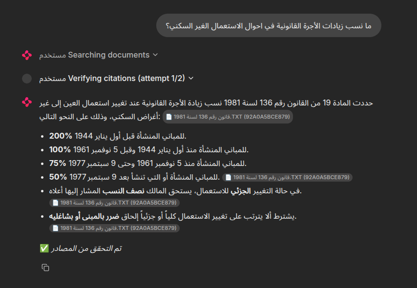

# Egyptian Real Estate Law RAG Agent
 
By [Youssef Tarek](https://www.linkedin.com/in/youssef-tarek-162049223/)
 


A RAG (Retrieval-Augmented Generation) chatbot built with extensive knowledge of Egyptian rent laws, construction laws, ownership, and more.
 
## Main Features
 
- **Dense + Sparse Retrieval Hybrid:** The retrieval uses a weighted dense and sparse hybrid to accurately retrieve relevant chunks. The sparse retrieval used is BM25.
- **Citation Verification:** Every claim made by the chatbot is verified a second time by another agent to ensure there are no hallucinations or unverified claims.
- **MCP Server:** The retrieval and verification parts are available as separate tools in an MCP server.



## Laws Covered
 
1. القانون المدني المصري رقم 131 لسنة 1948
2. قانون رقم 4 لسنة 1996
3. قانون رقم 230 لسنة 1996
4. قانون رقم 136 لسنة 1981
5. قانون رقم 114 لسنة 1946
6. اللائحة التنفيذية لقانون التصالح فى بعض مخالفات البناء وتقنين أوضاعها الصادر بالقانون رقم 187 لسنة 2023 المعدل بقرار رقم 3504 لسنة 2024
7. قانون رقم 49 لسنة 1977
8. القرار رقم 144 لسنة 2009 - اللائحة التنفيذية لقانون البناء
9. قانون رقم 164 لسنة 2025
10. مرسوم رقم 2 لسنة 1946 - اللائحة التنفيذية لقانون تنظيم الشهر العقاري
11. قانون رقم 119 لسنة 2008
12. قانون رقم 187 لسنة 2023
## Tech Stack
 
- Python
- LangChain
- Chroma
- Chainlit
- Qwen or DashScope API
## Models Used
 
- **Chatbot:** `qwen-3.8-flash`
- **Embedding Model:** `qwen3.7-text-embedding`

## Configuration
Environment variables: `DASHSCOPE_API_KEY`, `OPENAI_API_KEY`
`OPENAI_API_KEY` is for the word embeddings, this is for Qwen embedding models and will not work with OpenAI despite the name (see clients.py to change the models from Qwen).
`DASHSCOPE_API_KEY` is for the agent, also use Qwen model API key

## Instructions to Run
 
1. Clone the repository:
```bash
git clone https://github.com/Youssef1241/real-estate-rag.git
```
 
2. Set up the MCP server environment:
```bash
cd real-estate-rag
poetry install --no-root
```
 
    Then set up the frontend environment:
 
```bash
cd frontend
poetry install --no-root
```
 
3. Create the embeddings:
```bash
# run from real-estate-rag folder not frontend
poetry run python create_new_embeddings.py --input-dir texts
```
 
    The `texts` folder contains all the law texts.
    The default mode is persistent storage; feel free to change it.
 
4. Run the server and the frontend:
```bash
poetry run python server.py  # from real-estate-rag folder
# port 8001
```
```bash
poetry run chainlit run app.py  # from frontend folder
# port 8000
```
 
5. Connect to the MCP server:
    - In the Chainlit UI, click the plugin button in the search bar (it should be at the bottom left).
    - Find the `rag-docs` server and click **Connect**.
### Optional
 
Change the `language` variable in `frontend/config.toml` to change the language.
 
## Retrieval Results
 
On a manually created 22-question test set, which contains 15 standard questions and 7 questions asking for exact articles (available in `new_test_set2.json`), the retrieval recall score was 0.81 (0.75 for standard questions and 0.8 for exact-article questions).

To recreate the results, rerun `evaluate_retrieval.ipynb`
 
> ⚠️ **Disclaimer:** This tool provides general legal information, not legal advice. AI-generated answers may contain errors, so always verify against the official text of the law and consult a qualified lawyer for your specific situation.
 